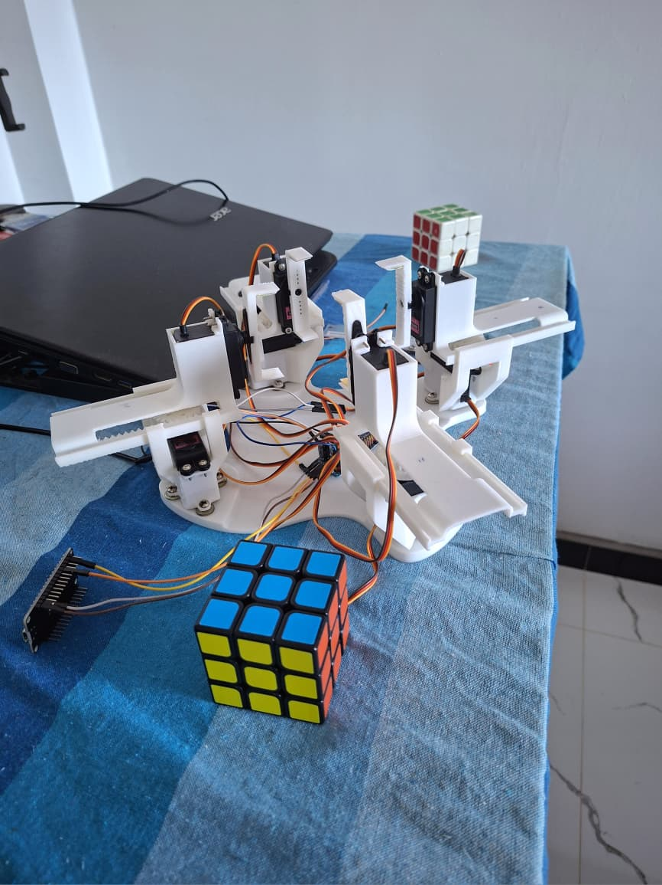

# Rubik Cube Solver Project

This repository contains three parts that work together to scan a Rubik's Cube, solve it, and optionally drive a physical robot:

- Backend: Flask and OpenCV code for color detection, solver integration, and hardware control.
- Frontend: a browser-based 3D cube interface for scanning, correcting colors, and viewing moves.
- Firmware: ESP32 Arduino sketches for servo and robot testing.

## Backend Folder

The backend folder contains multiple Flask entry points and helper scripts. They are variations of the same core workflow: detect cube stickers with OpenCV, convert the detected state into a 54-character cube string, solve it with the two-phase solver, and optionally send commands to hardware.

### Main scripts

- `Color_Extraction.py`: scans a static image, detects cube stickers, and exposes `/api/cube-colors` and `/api/solve`.
- `Color_Extraction_With_Video.py`: uses a live webcam stream, exposes `/video_feed`, and returns the current detected face from `/api/cube-colors`.
- `Build_for_esp.py`: webcam scanner plus USB serial output to an ESP32 robot.
- `Build_to_esp_2.py`: hardware-focused variant with a calibrated rack-and-pinion servo mapping.
- `Build_to_esp_3.py`: interactive hardware variant that reuses movement helpers from `Cube_movements.py`.
- `Rubik_Cube_Solver.py`: solver entry point that couples webcam scanning with threaded robot execution.
- `Cube_movements.py`: shared motor and cube-flip helpers used by the robot-control variants.

### Supporting files

- `tables.json`: solver-related lookup data used by the project.
- Sample images such as `rub.jpeg`, `rubbt3.jpeg`, and similar files for image-based testing.
- `Dockerfile` and `docker-compose.yml`: container setup for the backend environment.

### Hardware image



### Backend capabilities

- Detects cube colors with OpenCV using HSV thresholds.
- Sorts detected blocks top-to-bottom and left-to-right.
- Returns detected stickers as JSON with IDs and coordinates.
- Solves a 54-character cube state using the two-phase solver.
- Streams webcam frames with contour overlays in the live-video variants.
- In hardware-enabled variants, sends move sequences to an ESP32 over USB serial.

### Backend API

`GET /api/cube-colors`

Returns the detected stickers for the current image or webcam frame.

Response fields include:

- `id`
- `color`
- `center_coordinates.x`
- `center_coordinates.y`

`POST /api/solve`

Request body:

```json
{
  "cube_string": "<54-character cube string>"
}
```

Response:

```json
{
  "moves": ["U", "R2", "F", "B'"]
}
```

`GET /video_feed`

Available in the webcam-based backend variants. Streams the annotated camera image as MJPEG.

### Backend requirements

- Python 3.9 or newer.
- OpenCV, NumPy, Flask, Flask-CORS, and twophase.
- A webcam for the live-video scanner.
- An ESP32 and USB serial connection for the hardware-control scripts.

Install the common Python dependencies with:

```bash
pip install flask flask-cors opencv-python numpy twophase pyserial keyboard
```

### Backend run options

Static image scanner:

```bash
python Color_Extraction.py
```

Live webcam scanner:

```bash
python Color_Extraction_With_Video.py
```

Hardware-enabled variants:

```bash
python Build_for_esp.py
python Build_to_esp_2.py
python Build_to_esp_3.py
python Rubik_Cube_Solver.py
```

The backend normally serves on `http://127.0.0.1:5000`.

## Frontend Folder

The frontend folder contains a browser UI built around a 3D Rubik's Cube visualizer.

### Files

- `index.html`: page layout for the live scanner panel, 3D cube scene, move buttons, scan button, paint palette, shuffle button, and solve button.
- `main.js`: Three.js scene setup, cube rendering, move animation logic, scramble behavior, and UI interactions.
- `styles.css`: visual styling for the interface, including the dark panel layout and responsive behavior.

### Frontend features

- Displays the live backend video stream inside the scanner panel.
- Renders a 3D Rubik's Cube with textured stickers.
- Supports manual cube moves and scramble generation.
- Provides a scan workflow for capturing a face from the webcam.
- Lets you paint incorrect stickers before solving.
- Requests the solution from the backend and animates the resulting move sequence.

### Frontend dependencies

The frontend loads Three.js, OrbitControls, and RoundedBoxGeometry directly from esm.sh, so it can run as a static web page without a bundler.

## Firmware Folder

The firmware folder contains ESP32 Arduino sketches used to test and control the robot hardware.

### Main sketches

- `ServoControler.ino`: ESP32 web server that accepts move commands over HTTP and drives a single servo for testing.
- `ControlWitDriver/ControlWitDriver.ino`: ESP32 I2C scanner used to verify PCA9685 or other I2C hardware.
- `DriverTest/DriverTest.ino`: USB serial robot-control experiment with calibration data and manual keyboard helpers.
- `ServoController2/ServoController2.ino`: another servo-control sketch for alternative motor wiring or calibration.
- `Test1/Test1.ino`: minimal test sketch for simple servo movement checks.

### Firmware purpose

- Verify servo ranges and hardware wiring.
- Test USB or Wi-Fi based move execution.
- Experiment with cube flip logic and face-turn calibration before integrating with the backend.

## Overall Workflow

1. Use the frontend to scan or manually correct cube colors.
2. Send the detected 54-character cube string to the backend solve endpoint.
3. Receive the move list from the solver.
4. Optionally forward those moves to the firmware-controlled robot.

## Notes

- The HSV thresholds in the backend are hardcoded and may need tuning for your camera and lighting.
- The live webcam variants expect the cube to be centered and clearly visible.
- The hardware scripts use different servo-calibration strategies, so choose the one that matches your robot build.
